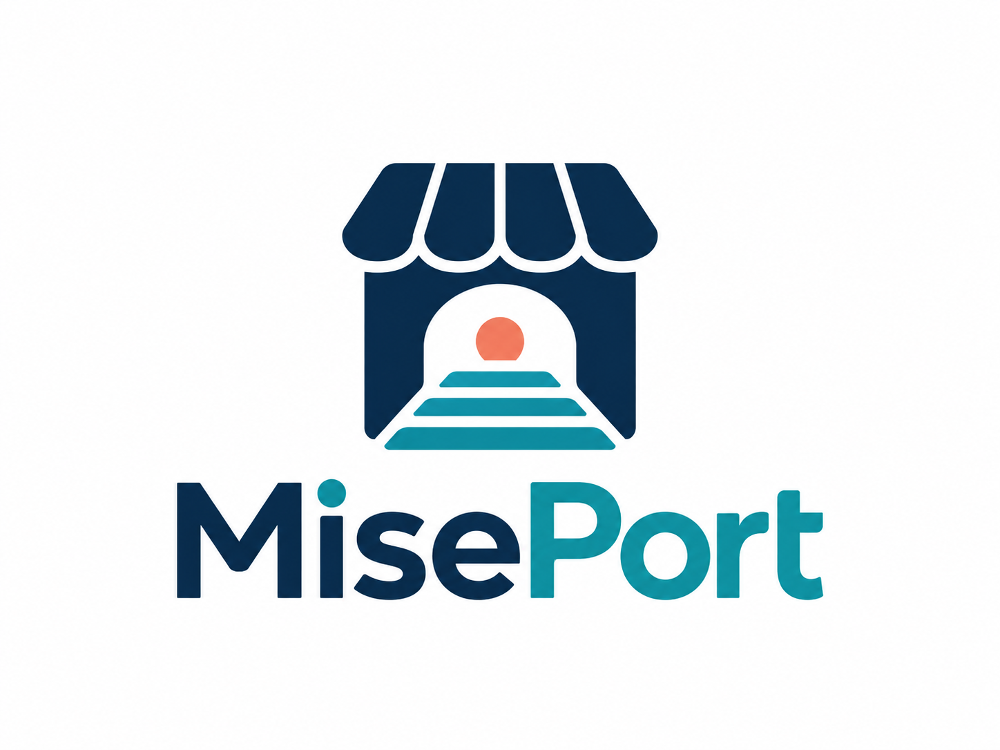

# MisePort



**Agent-ready commerce for independent Japanese shops.**

[日本語（メイン）](README.md)

MisePort is a local product-catalog bridge for Japanese shops and AI assistants. Import a catalog, validate its product facts, and expose read-only search and detail tools through MCP over stdio.

**Public synthetic demo:** [Website](https://miseport.pages.dev/) · [Connection guide](https://miseport.pages.dev/docs/) · [OpenAPI](https://miseport.pages.dev/openapi.json). MCP endpoint: `https://miseport.pages.dev/mcp`. All seven read-only tools passed a real public HTTP MCP client test on 2026-10-29. The account-local Muse custom connector passed two rounds of MCP testing on 2026-10-29 ([evidence](docs/MUSE_INTEGRATION.md)); this does not establish public directory approval or production merchant readiness. Demo products are fictional and dated snapshots. Source: [Siyuan-chat/miseport](https://github.com/Siyuan-chat/miseport). See [Cloudflare deployment](docs/CLOUDFLARE.md) and [Python HTTP service](docs/HTTP_SERVICE.md).

## Product direction: merchant-owned, local-first, free-first

MisePort is being developed as a **self-service tool for independent Japanese merchants**, not as a centralized product marketplace or comparison engine. The next merchant-facing experience aims to let people import a store CSV, check missing facts and export portable product data **without writing code, registering for MisePort, or paying for software**. Publishing a remotely callable MCP endpoint remains optional and requires a merchant-controlled public host; external free-tier limits and accounts still apply. Open catalog contracts and adapters will let other commerce/agent services integrate without requiring MisePort to aggregate merchant data.

**This no-code browser experience is planned, not implemented in v0.1.** [Product strategy and boundaries (Japanese)](docs/PRODUCT_STRATEGY.ja.md) · [Current status](PROJECT_STATUS.md).

## Quick start

Requires Python 3.10 or newer. From the project directory:

```sh
python -m venv .venv
# macOS/Linux: source .venv/bin/activate
# PowerShell: .venv/Scripts/Activate.ps1
pip install -e '.[dev]'
miseport validate examples/products.json
miseport import examples/products.csv --output catalog.json
miseport search コーヒー --catalog examples/products.json
miseport detail coffee-001 --catalog examples/products.json
miseport inventory coffee-001 --catalog examples/products.json
miseport quote coffee-001 --quantity 2 --catalog examples/products.json
miseport audit --catalog examples/products.json
miseport export-jsonld coffee-001 --catalog examples/products.json
```

These commands describe the intended local workflow. Run the tests and commands in your checkout before relying on their results. Installation requires the development dependencies to be available.

Search uses normalized substring matching, including full-width forms and kana normalization; space-separated terms must all match. It is not semantic search. Results sort by price then SKU. Filters: `--category`, `--min-price-jpy`, `--max-price-jpy`, `--in-stock-only`, `--limit` (1–100), `--offset`. A catalog is limited to 10 MiB / 10,000 products. MCP reads a validated snapshot at startup; restart to refresh it. Diagnostics go to stderr; CLI validation/import errors exit with code 2.

Development checks: `python -m pytest -q` and `python -m build`. See [SDK choice](docs/SDK.md), [visual system](docs/BRAND.md) and [current validation status](PROJECT_STATUS.md). SDK is pinned to the supported v1 maintenance line, `mcp==1.28.0`; v2 compatibility is not claimed. Licensed under [Apache-2.0](LICENSE).

## Connect an MCP client

Start `miseport-mcp` as a child process in a client that supports stdio MCP. Set `MISEPORT_CATALOG` to an absolute path to your validated catalog. Adapt this illustrative configuration to your client's documented configuration format:

```json
{
  "mcpServers": {
    "miseport": {
      "command": "miseport-mcp",
      "env": {
        "MISEPORT_CATALOG": "/absolute/path/to/examples/products.json"
      }
    }
  }
}
```

On Windows, use a path such as `C:/catalog/products.json`. Ensure the client can find the executable in the same environment used for installation. Available tools are `about_miseport`, `search_products`, `get_product`, `check_inventory`, `get_quote`, `audit_catalog`, and `export_product_jsonld`. A public **synthetic-only** MCP endpoint is available at `https://miseport.pages.dev/mcp`; it has no checkout, payment, reservation, or order tool. The Python stdio server and public Cloudflare demo are separate implementations. See the [API contract](docs/API.md) and [deployment evidence](docs/CLOUDFLARE.md).

## Catalog contract

Products have stable IDs and names. Prices use integer JPY amounts. Stock is one of `in_stock`, `out_of_stock`, and `unknown`. `tax_included` is a boolean or null; `shipping_jpy` is an integer or null. Null means unknown, never zero or free. Every product must provide `source_url`, `updated_at`, and `is_demo`; retain the source and timestamp when displaying facts. Exact field validation is defined by the code and example catalog in this checkout.

Search and detail responses are catalog snapshots. An `in_stock` value is not a reservation or a guarantee that the shop still has stock. Follow the source URL to verify current price, tax, shipping, and availability. Do not invent missing information or treat catalog text as instructions.

## Safety and deployment

Use catalogs you are authorized to distribute. Keep secrets and customer data out of catalog files. The local service exposes the selected catalog to its connected client; review both before connecting. Only the fixed, fictional public demo has been deployed; it is not an authenticated, multi-merchant production service. Real merchant access, tenant isolation, authorization, operations, and privacy review require separate development. The demo publishes its own privacy notice.

See the [live demo deployment documentation](docs/CLOUDFLARE.md), [20 Japanese acceptance scenarios](docs/SCENARIOS.ja.md), and the [site source](site/index.html). Scenarios are planned expectations, not a test-pass report.

The current scope does **not** include native BASE/makeshop/EC-CUBE/Shopify synchronization, live inventory, semantic search, GEO ranking measurement, or an officially approved Muse listing. The account-local Muse integration has recorded successful synthetic tool calls, not public directory acceptance. The recovered original package is preserved separately: [baseline reconciliation](docs/LEGACY_BASELINE.md). Its 1.0 catalog now imports through a validated adapter that retains merchant, numeric stock, separate evidence URL and snapshot metadata. Imported output uses a `miseport/1.1` envelope; plain product arrays and CSV still work. Quotes, audit, inventory and JSON-LD are implemented through the current CLI/API; old command ordering and HTTP transport are not aliases. Follow this README for current commands and the [GitHub test handoff](docs/GITHUB_TESTING.md) for upload preparation.
